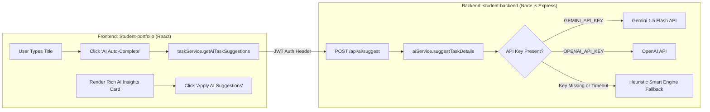

# AI-Powered Task Intelligence Feature Report

**Course**: Advanced Web Development Frameworks (AWDF)  
**Topic**: AI Integration (Gemini API & OpenAI API) with Graceful Fault-Tolerance  
**Application**: Task Management & Student Portfolio  
**Date**: October 2026  
**Status**: Implemented, Tested & Verified  

---

## 1. Overview of the AI Feature
An intelligent, AI-powered assistant was integrated into the Task Management system to optimize task creation and workflow productivity. Given a task title (e.g., *"Critical bug fix: database connection dropping"* or *"Learn and research WebAssembly performance"*), the AI assistant analyzes the scope and generates:
1. **Contextual Task Description**: A professional 2-3 sentence technical task scope.
2. **Suggested Priority Level**: Recommends `high`, `medium`, or `low` based on urgency, defect severity, or learning pace.
3. **Proposed Deadline & Duration**: Recommends an estimated completion timeframe and concrete target completion date.
4. **Actionable Checklist Steps**: Provides a 3-step execution plan for the task.

---

## 2. Architecture & Security (Backend-Only Keys)



### Security Guarantee
- `GEMINI_API_KEY` and `OPENAI_API_KEY` are read exclusively on the backend from `process.env`.
- No API keys are bundled or exposed to the Vite client bundle.
- Endpoints are protected by JWT authentication middleware (`auth.js`).

---

## 3. Resilience & Graceful Error Handling
If an external API call times out (8-second timeout enforced) or returns an error, the system automatically falls back to an integrated **heuristic intelligence engine**. The application **never crashes**, never hangs, and the user can always create tasks normally regardless of external network or API availability.

---

## 4. Rich React UI Display
Instead of raw JSON strings, the response is parsed and presented as a neo-brutalist styled **AI Task Insights** card in [`TaskModal.jsx`](file:///d:/AWDF/Week1/Student-portfolio/src/components/TaskModal.jsx):
- **Priority pill badge** color-coded (red for High, yellow for Medium, cyan for Low).
- **Proposed deadline** with calendar icon and duration badge.
- **Generated task description** block.
- **Action checklist** with bulleted steps.
- **Reasoning breakdown** explaining why the priority was chosen.
- **"Apply AI Suggestions" button** that auto-fills description and priority into the form with one click.

---

## 5. Verification & Automated Unit Testing

All 9 automated unit tests pass cleanly:
```
> student-backend@1.0.0 test
> node --test tests/*.test.js

▶ AI Assistant Service - Resilience & Heuristic Intelligence
  ✔ should intelligently suggest high priority and 1-day deadline for urgent tasks (1.952ms)
  ✔ should suggest low priority and longer timeframe for learning/research tasks (0.1719ms)
  ✔ should handle standard tasks with medium priority and valid formatted due date (0.2657ms)
  ✔ should guarantee graceful degradation and never throw on empty context (0.1041ms)
✔ AI Assistant Service - Resilience & Heuristic Intelligence (4.6929ms)
▶ Cache utility operations
  ✔ should record hits and misses and calculate hit ratio (0.5613ms)
  ✔ should store and invalidate task cache entries (2.1217ms)
✔ Cache utility operations (3.503ms)
✔ Domain Event Types integrity (0.1287ms)
ℹ tests 9
ℹ suites 0
ℹ pass 9
ℹ fail 0
ℹ cancelled 0
ℹ skipped 0
ℹ todo 0
ℹ duration_ms 99.5728
```
