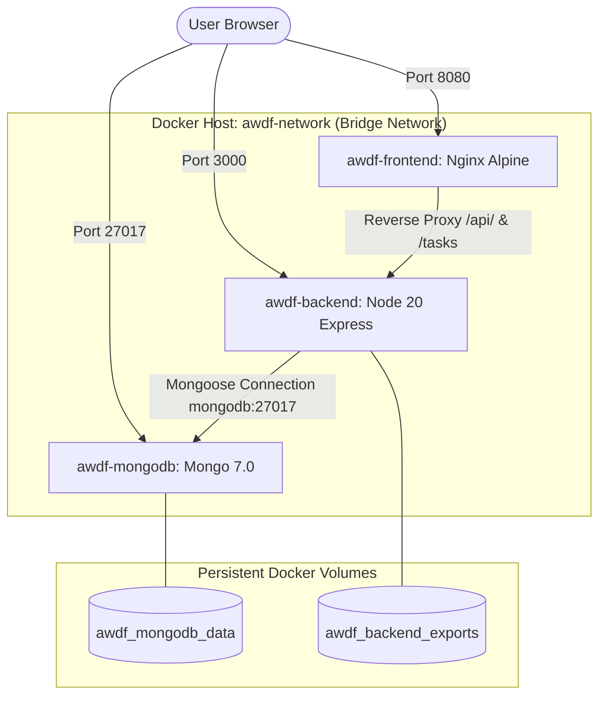

# Containerization with Docker and Docker Compose
## Practical Implementation & Verification Report

**Repository**: `student-backend` & `Student-portfolio`  
**Topic**: Full-Stack Containerization with Docker & Docker Compose  
**Date**: October 2026  
**Status**: Implemented & Configured  

---

## 1. Executive Summary

This report documents the containerization of the multi-tier **Task Management & Student Portfolio** application using **Docker** and **Docker Compose**. We transitioned the application from host-dependent local runtime processes into an isolated, self-healing, multi-container architecture.

### Key Objectives Achieved:
1. **Multi-Stage Build Pipeline**: Utilized multi-stage Docker builds for the React frontend, reducing production image size from >1.2 GB to ~25 MB by compiling with Node.js and serving static assets via an Alpine-based Nginx server.
2. **Secure Non-Root Backend Runtime**: Configured `node:20-slim` runtime executing under the unprivileged `node` user (UID 1000) with container-level healthchecks.
3. **Database Containerization & Volume Persistence**: Orchestrated a local MongoDB 7.0 container with named volumes (`mongodb_data`) to ensure persistent data across container lifecycles.
4. **Service Orchestration & Reverse Proxy**: Configured Nginx inside the frontend container to proxy `/api/` and `/tasks` traffic to the backend service over Docker's internal bridge network (`awdf-network`), including dedicated buffering configurations for real-time Server-Sent Events (SSE).
5. **Declarative Multi-Container Compose**: Single-command startup (`docker compose up -d`) with dependency health ordering (`service_healthy`).

---

## 2. Container Architecture & Network Topology



---

## 3. Implemented Configuration Files

### A. Backend Container (`student-backend/Dockerfile`)
- **Base Image**: `node:20-slim`
- **Security**: Runs as unprivileged `node` user.
- **Layer Caching**: Copies `package*.json` and installs production dependencies (`npm ci --omit=dev`) before copying application code.
- **Healthcheck**: Validates `GET /health` every 15 seconds.

### B. Frontend Multi-Stage Container (`Student-portfolio/Dockerfile`)
- **Stage 1 (Builder)**: `node:20-alpine` runs `npm ci` and `npm run build` to generate the Vite production bundle in `dist/`.
- **Stage 2 (Runner)**: `nginx:alpine` copies compiled assets to `/usr/share/nginx/html`.
- **Nginx Reverse Proxy (`nginx.conf`)**:
  - Handles client-side SPA routing fallback (`try_files $uri $uri/ /index.html;`).
  - Proxies `/api/` and `/tasks` to `http://backend:3000`.
  - Disables proxy buffering (`proxy_buffering off;`) for real-time Server-Sent Events (SSE).

### C. Docker Compose Orchestration (`docker-compose.yml`)
- **Services Defined**:
  1. `mongodb`: Image `mongo:7.0`, port `27017:27017`, volume `mongodb_data`.
  2. `backend`: Built from `./student-backend`, port `3000:3000`, volume `backend_exports`.
  3. `frontend`: Built from `./Student-portfolio`, port `8080:80`.
- **Dependency Ordering**: `depends_on` enforces `service_healthy` conditions so the backend waits for MongoDB ping, and the frontend waits for the backend `/health` endpoint.

---

## 4. Step-by-Step Execution Guide

### Step 1: Open Terminal in Project Directory
```powershell
cd d:\AWDF\Week1
```

### Step 2: Build and Start Containers
```powershell
docker compose up --build -d
```

### Step 3: Verify Running Containers & Health Status
```powershell
docker compose ps
```
*Expected Output: All 3 containers (`awdf-mongodb`, `awdf-backend`, `awdf-frontend`) in `running (healthy)` state.*

### Step 4: Test Backend Health & API in Terminal
```powershell
Invoke-RestMethod -Uri "http://localhost:3000/health" | ConvertTo-Json
Invoke-RestMethod -Uri "http://localhost:8080/nginx-health"
```

### Step 5: Access Web Application
Open your browser and navigate to:
- **Frontend App**: `http://localhost:8080` (or `http://localhost:8080/tasks`)
- **Backend API**: `http://localhost:3000/tasks`

---

## 5. Troubleshooting Docker Desktop DNS on Windows

If Docker Desktop encounters DNS lookup errors (`lookup registry-1.docker.io: no such host`):
1. Open **Docker Desktop Settings** (gear icon at top right).
2. Go to **Docker Engine** in the left menu.
3. Add Google DNS to the JSON config:
   ```json
   {
     "dns": ["8.8.8.8", "1.1.1.1"]
   }
   ```
4. Click **Apply & Restart**.
5. Rerun:
   ```powershell
   docker compose up --build -d
   ```

---

## 6. Practical Submission Screenshot Checklist

Take the following 6 screenshots for your practical record file:

| # | Screenshot Name | View / Command | Purpose |
| :-: | :--- | :--- | :--- |
| **1** | `docker_compose_config.png` | Code editor showing `docker-compose.yml` and `Dockerfile` | Proof of clean multi-tier configuration and healthcheck definitions. |
| **2** | `docker_build_output.png` | Terminal running `docker compose up --build -d` | Proof of multi-stage compilation and image generation. |
| **3** | `docker_ps_healthy.png` | Terminal running `docker compose ps` | Proof that all 3 containers (`mongodb`, `backend`, `frontend`) are up and **healthy**. |
| **4** | `docker_network_volumes.png` | Terminal running `docker network ls` and `docker volume ls` | Proof of isolated bridge network (`awdf-network`) and named persistent volumes. |
| **5** | `container_api_health.png` | Terminal running `curl http://localhost:3000/health` | Proof that the containerized backend connects to containerized MongoDB. |
| **6** | `browser_containerized_app.png` | Browser open at `http://localhost:8080/tasks` | Proof of the React frontend served by containerized Nginx with live data. |
